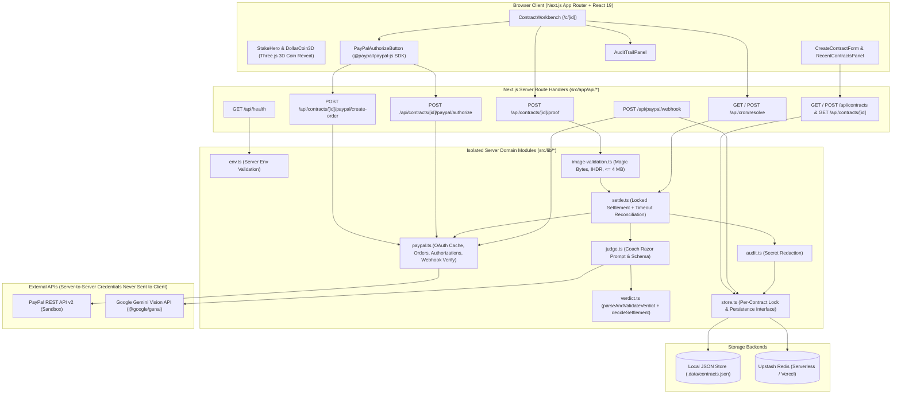
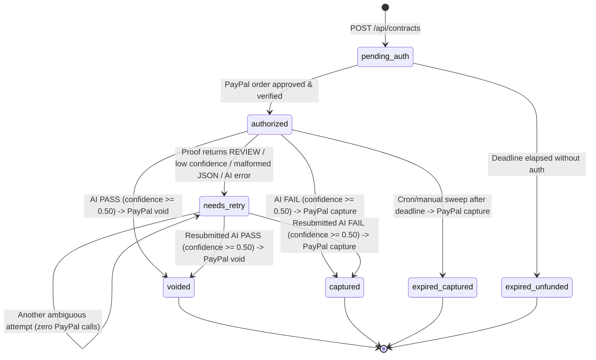

# STAKE

> **Put $5–$50 USD into a PayPal authorization hold and prove your commitment before the clock runs out — or an AI judge triggers a server-side capture.**

STAKE is an AI-enforced commitment staking platform built with **Next.js 16**, **React 19**, **TypeScript**, **Three.js**, **PayPal REST API v2 (Sandbox)**, and **Google Gemini Vision (`Coach Razor`)**. Users fund a conditional USD commitment hold via PayPal (`intent=AUTHORIZE`), submit real photographic/screenshot proof before the deadline, and let a credential-isolated AI judge evaluate the evidence — voiding the hold on pass or capturing the stake on fail, with every API call recorded in a secret-redacted Audit Trail.

---

## Table of Contents

- [Visual & Product Experience](#visual--product-experience)
- [Architecture Diagrams](#architecture-diagrams)
  - [1. System & Security Boundary Architecture](#1-system--security-boundary-architecture)
  - [2. End-to-End Payment & AI Verdict Sequence](#2-end-to-end-payment--ai-verdict-sequence)
  - [3. Contract Lifecycle State Machine](#3-contract-lifecycle-state-machine)
- [Repository Structure](#repository-structure)
- [API Endpoints](#api-endpoints)
- [Security & Financial Safeguards](#security--financial-safeguards)
- [Environment Configuration](#environment-configuration)
- [Quick Local Setup](#quick-local-setup)
- [Testing & Verification](#testing--verification)
- [Deployment (Vercel + Upstash Redis)](#deployment-vercel--upstash-redis)
- [Documentation Index](#documentation-index)
- [License](#license)

---

## Visual & Product Experience

- **Cinematic 3D Opening (`StakeHero` + `DollarCoin3D`)**: Full-viewport Three.js WebGL US Dollar metallic coin entrance that slides to center, rotates in 3D, zooms out, and integrates directly as the circular body of lowercase `a` inside **STAKE**.
- **Minecraft-Inspired Sharp-Edge Fintech UI**: Strict **Black / White / Yellow** palette (`globals.css`), 90-degree corners, block shadows, pixel SVG icons (`PixelIcons`), editable USD stake selector (`$5–$50 USD`), quick presets/slider, recent contracts ledger, and a dedicated `/c/[id]` Contract Workbench.

---

## Architecture Diagrams

### 1. System & Security Boundary Architecture



### 2. End-to-End Payment & AI Verdict Sequence

```mermaid
sequenceDiagram
    autonumber
    actor User
    participant UI as Next.js Client (/c/[id])
    participant API as Next.js Server (/api/*)
    participant PP as PayPal REST v2 (Sandbox)
    participant AI as Gemini Vision (Coach Razor)

    User->>API: POST /api/contracts (goal, $5-$50, deadline, beneficiary)
    API-->>User: Shareable contract /c/[id] (status: pending_auth)

    User->>UI: Click PayPal Smart Button (intent=authorize)
    UI->>API: POST /api/contracts/[id]/paypal/create-order
    API->>PP: POST /v1/oauth2/token (cached until expiry)
    API->>PP: POST /v2/checkout/orders (intent: AUTHORIZE, PayPal-Request-Id)
    PP-->>API: orderId + PayPal-Debug-Id
    User->>PP: Buyer approves order in PayPal Sandbox popup
    UI->>API: POST /api/contracts/[id]/paypal/authorize
    API->>PP: POST /v2/checkout/orders/{orderId}/authorize
    API->>PP: Verify amount, USD currency, custom_id & status
    PP-->>API: purchase_units[0].payments.authorizations[0].id
    API-->>UI: status: authorized (funds held, NO capture yet)

    User->>API: POST /api/contracts/[id]/proof (JPEG/PNG/WEBP <= 4 MB)
    API->>AI: Send Base64 inlineData bytes + untrusted goal JSON
    AI-->>AI: Model has ZERO PayPal credentials or tools
    AI-->>API: Strict JSON { verdict: PASS|FAIL|REVIEW, confidence, reason, feedback }

    alt REVIEW, invalid JSON, AI error, or confidence < 0.50
        API-->>UI: status: needs_retry (NO PayPal call; authorization preserved)
    else PASS and confidence >= 0.50
        API->>PP: GET /v2/payments/authorizations/{authId} (eligibility check)
        API->>PP: POST /v2/payments/authorizations/{authId}/void
        PP-->>API: 204/200 VOIDED + PayPal-Debug-Id
        API-->>UI: status: voided (hold released)
    else FAIL and confidence >= 0.50
        API->>PP: GET /v2/payments/authorizations/{authId} (eligibility check)
        API->>PP: POST /v2/payments/authorizations/{authId}/capture
        PP-->>API: 201 COMPLETED + PayPal-Debug-Id
        API-->>UI: status: captured (stake forfeited)
    end

    PP->>API: POST /api/paypal/webhook (PAYMENT.AUTHORIZATION.* / PAYMENT.CAPTURE.COMPLETED)
    API->>PP: POST /v1/notifications/verify-webhook-signature
    PP-->>API: verification_status: SUCCESS
    API-->>API: Deduplicate event.id & append verified event to Audit Trail
```

### 3. Contract Lifecycle State Machine



---

## Repository Structure

Every concern is modularized across dedicated files so UI, PayPal REST client, AI judging, validation, storage, and tests can be modified independently:

```text
stake/
├── src/
│   ├── app/
│   │   ├── page.tsx                                  # Landing page (Hero + Create Contract + Ledger)
│   │   ├── c/[id]/page.tsx                           # Shareable Contract Workbench page
│   │   ├── layout.tsx & globals.css                  # Fonts & Black/White/Yellow Minecraft pixel design tokens
│   │   └── api/
│   │       ├── health/route.ts                       # Safe config diagnostics (never exposes secrets)
│   │       ├── contracts/route.ts                    # GET list & POST create contract
│   │       ├── contracts/[id]/route.ts               # GET single contract by ID
│   │       ├── contracts/[id]/paypal/create-order/   # Create PayPal AUTHORIZE order
│   │       ├── contracts/[id]/paypal/authorize/      # Authorize order & verify hold
│   │       ├── contracts/[id]/proof/route.ts         # Upload image -> AI judge -> settle
│   │       ├── paypal/webhook/route.ts               # Verified & deduplicated webhook receiver
│   │       └── cron/resolve/route.ts                 # Capture expired authorized contracts
│   ├── components/
│   │   ├── StakeHero.tsx & DollarCoin3D.tsx          # 3D Three.js coin reveal + STAKE wordmark
│   │   ├── CreateContractForm.tsx                    # Goal, $5-$50 USD stake, beneficiary & duration form
│   │   ├── ContractWorkbench.tsx                     # Contract detail, countdown, upload & verdict UI
│   │   ├── PayPalAuthorizeButton.tsx                 # @paypal/paypal-js Smart Button wrapper
│   │   ├── AuditTrailPanel.tsx                       # Chronological PayPal + AI event log viewer
│   │   ├── RecentContractsPanel.tsx                  # Recent contracts list + manual Resolve Expired trigger
│   │   ├── NewStakeButton.tsx                        # Smooth scroll / focus trigger for new stakes
│   │   ├── StatusBadge.tsx & PixelIcons.tsx          # Pixel icons & contract status indicators
│   ├── hooks/
│   │   └── useNowMs.ts                               # Client countdown clock hook
│   └── lib/
│       ├── types.ts                                  # Contract, Verdict, ProofSubmission, Audit types & constants
│       ├── env.ts                                    # Env checks (assertPayPalEnv, assertGeminiEnv, getEnvDiagnostics)
│       ├── contracts.ts                              # Input validation & contract factory
│       ├── image-validation.ts                       # Magic-byte, MIME, PNG IHDR & size validation
│       ├── judge.ts                                  # Isolated Coach Razor prompt & Gemini Vision call
│       ├── verdict.ts                                # Strict JSON validation, 2-sentence clamp & routing policy
│       ├── paypal.ts                                 # PayPal OAuth cache, Orders/Auth/Capture/Void & webhook verification
│       ├── settle.ts                                 # Locked settlement orchestrator & expired contract sweep
│       ├── store.ts                                  # JsonFileContractStore (local) & UpstashRedisContractStore
│       ├── audit.ts                                  # AuditTrailEntry builder & bearer/secret sanitizer
│       └── __tests__/                                # Vitest unit test suites (36 tests across 7 files)
├── postman/
│   └── Stake.postman_collection.json                 # Standalone PayPal REST API v2 collection
├── .env.example                                      # Environment variable template (safe placeholder values)
├── vercel.json                                       # Vercel daily cron schedule (/api/cron/resolve)
└── vitest.config.mts                                 # Vitest config with @/ path alias
```

---

## API Endpoints

| Method | Endpoint | Purpose |
| --- | --- | --- |
| `GET` | `/api/health` | Returns non-secret readiness flags (`paypalConfigured`, `paypalClientSdkConfigured`, `paypalWebhookConfigured`, `paypalSandbox`, `geminiConfigured`, `storageMode`). |
| `GET` | `/api/contracts` | Lists stored contracts along with active `storage` backend (`json` or `upstash`). |
| `POST` | `/api/contracts` | Validates goal, beneficiary, USD stake (`$5–$50`), and duration (`1–4320` min) and creates a `pending_auth` contract. |
| `GET` | `/api/contracts/[id]` | Fetches full contract state, proof attempts, and redacted Audit Trail. |
| `POST` | `/api/contracts/[id]/paypal/create-order` | Creates a PayPal Checkout v2 order with `intent: AUTHORIZE` and deterministic `PayPal-Request-Id`. |
| `POST` | `/api/contracts/[id]/paypal/authorize` | Authorizes the buyer-approved order and verifies `USD` currency, exact cent amount, `custom_id`, and status. |
| `POST` | `/api/contracts/[id]/proof` | Validates `multipart/form-data` image (`<= 4 MB`), runs Coach Razor, and either voids (`PASS >= 0.50`), captures (`FAIL >= 0.50`), or preserves hold in `needs_retry`. |
| `POST` | `/api/paypal/webhook` | Verifies 5 required PayPal signature headers against `/v1/notifications/verify-webhook-signature`, deduplicates `event.id`, and updates the Audit Trail. |
| `GET` / `POST` | `/api/cron/resolve` | Captures overdue `authorized` contracts and expires unfunded `pending_auth` contracts; leaves `needs_retry` untouched. `GET` verifies `Authorization: Bearer $CRON_SECRET` when configured. |

---

## Security & Financial Safeguards

1. **Zero Client Secret Exposure**: `PAYPAL_CLIENT_SECRET`, `GEMINI_API_KEY`, `UPSTASH_REDIS_REST_TOKEN`, and `CRON_SECRET` are strictly server-side (`assertPayPalEnv`, `assertGeminiEnv`). Only `NEXT_PUBLIC_PAYPAL_CLIENT_ID` is exposed to the PayPal JS SDK.
2. **AI-to-PayPal Isolation**: `judgeProofWithCoachRazor` only receives image bytes + untrusted `CONTRACT_DATA_JSON`; Gemini cannot access PayPal credentials or trigger payments directly.
3. **Deterministic Money Routing (`decideSettlement`)**: `REVIEW`, invalid/non-JSON responses, AI API errors (`503`/timeouts), and `confidence < 0.50` always route to `needs_retry` with **zero PayPal capture or void calls**.
4. **Prompt-Injection Defense**: Contract goal text and any text inside uploaded images are treated strictly as untrusted data inside the fixed `COACH_RAZOR_SYSTEM_PROMPT`.
5. **Upload Hardening (`validateProofImage`)**: Enforces `<= 4 MB` size, allowed MIME (`image/jpeg`, `image/png`, `image/webp`), matching file extension, raw magic-byte verification, PNG `IHDR` non-zero dimensions, and rejects `<svg>`, `<?xml`, `<!doctype`, `<html>`, and `<script>` polyglots in memory without writing uploads to disk.
6. **Double-Settlement Guard & Timeout Reconciliation**: Per-contract locks (`store.withLock`), idempotency headers (`PayPal-Request-Id`), pre-settlement authorization status checks, and post-timeout reconciliation prevent duplicate captures or voids.
7. **Audit Redaction**: `sanitizeAuditSummary` in `src/lib/audit.ts` scrubs bearer/basic tokens and credential strings before persisting any audit record.

---

## Environment Configuration

Copy `.env.example` to `.env` (`.gitignore` excludes `.env*` except `!.env.example` — **never commit `.env`**):

| Variable | Required | Notes |
| --- | --- | --- |
| `PAYPAL_CLIENT_ID` | Yes | PayPal Sandbox REST App Client ID |
| `PAYPAL_CLIENT_SECRET` | Yes | PayPal Sandbox REST App Secret |
| `NEXT_PUBLIC_PAYPAL_CLIENT_ID` | Yes | Same Sandbox Client ID for `@paypal/paypal-js` |
| `PAYPAL_BASE_URL` | Optional | Defaults to `https://api-m.sandbox.paypal.com` |
| `PAYPAL_WEBHOOK_ID` | Webhook only | Sandbox Webhook ID from PayPal Developer Dashboard |
| `GEMINI_API_KEY` | Yes | Google AI Studio API key (`@google/genai`) |
| `GEMINI_MODEL` | Recommended | Vision model ID (e.g. `gemini-3.6-flash`) |
| `UPSTASH_REDIS_REST_URL` | Vercel / prod | Enables `UpstashRedisContractStore`; local defaults to `.data/contracts.json` |
| `UPSTASH_REDIS_REST_TOKEN` | Vercel / prod | Companion REST token for Upstash Redis |
| `CRON_SECRET` | Recommended | Protects `GET /api/cron/resolve` via Bearer auth |

---

## Quick Local Setup

```bash
npm install
cp .env.example .env
# Fill in your PayPal Sandbox & Gemini API credentials in .env
npm run dev
```

Open [http://localhost:3000](http://localhost:3000) and confirm configuration readiness at [http://localhost:3000/api/health](http://localhost:3000/api/health).

---

## Testing & Verification

```bash
npm test        # Runs all 36 Vitest unit tests across 7 test suites (mocked PayPal/AI doubles)
npm run lint    # ESLint checks
npm run build   # Next.js 16 production TypeScript/Turbopack build
```

> **Verification Scope:** `npm test` validates contract rules, environment checks, image magic-byte validation, verdict JSON parsing & decimal formatting guards, webhook verification/deduplication, and settlement edge cases using mocked HTTP/AI doubles. End-to-end PayPal Sandbox holds and live Gemini Vision evaluations require valid `.env` credentials (see [SANDBOX_TESTING.md](SANDBOX_TESTING.md)).

---

## Deployment (Vercel + Upstash Redis)

Local file storage (`.data/contracts.json`) is intended for local development only; serverless deployments require Upstash Redis (`UPSTASH_REDIS_REST_URL` and `UPSTASH_REDIS_REST_TOKEN`) for shared contract state and distributed `NX` locks. See [VERCEL_DEPLOYMENT.md](VERCEL_DEPLOYMENT.md) for the complete deployment and smoke-test checklist.

---

## Documentation Index

- [ENVIRONMENT_SETUP.md](ENVIRONMENT_SETUP.md) — Step-by-step credential setup (PayPal Sandbox, Gemini, Webhook ID, Upstash).
- [SANDBOX_TESTING.md](SANDBOX_TESTING.md) — Local ngrok webhook testing + full manual Sandbox test matrix (`PASS` / `FAIL` / `REVIEW` / expired).
- [VERCEL_DEPLOYMENT.md](VERCEL_DEPLOYMENT.md) — Production Vercel + Upstash Redis checklist.
- [DEMO_SCRIPT.md](DEMO_SCRIPT.md) & [DEMO_CHECKLIST.md](DEMO_CHECKLIST.md) — Under-3-minute demo script and pre-flight check.
- [DEVPOST_SUBMISSION.md](DEVPOST_SUBMISSION.md) — Project overview writeup.
- [postman/Stake.postman_collection.json](postman/Stake.postman_collection.json) — Raw PayPal REST API v2 collection (`token`, `create order`, `authorize`, `capture`, `void`).

---

## License

MIT — see [LICENSE](LICENSE).
